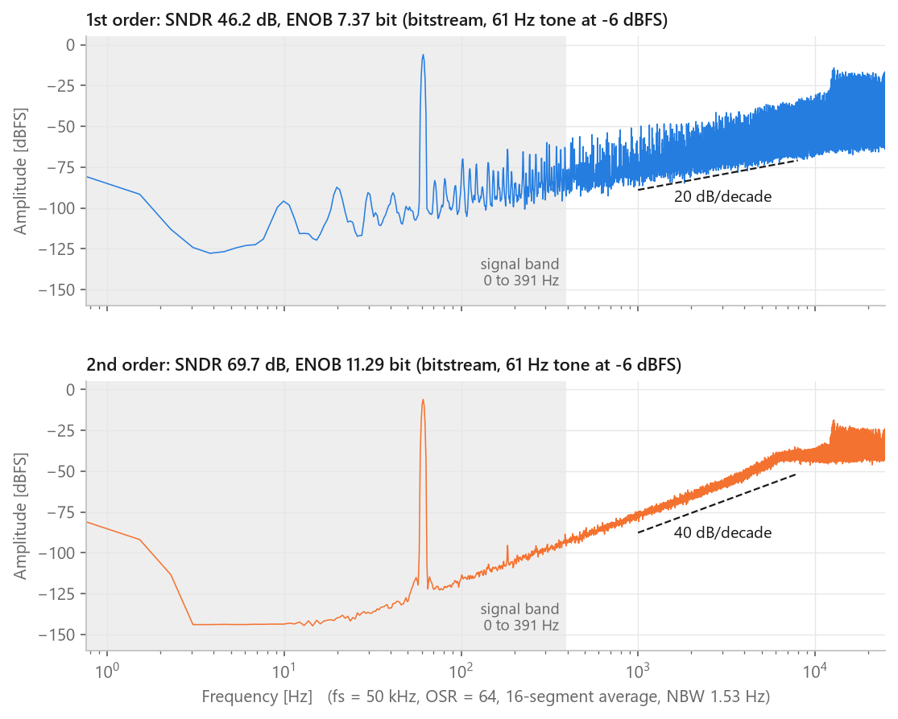
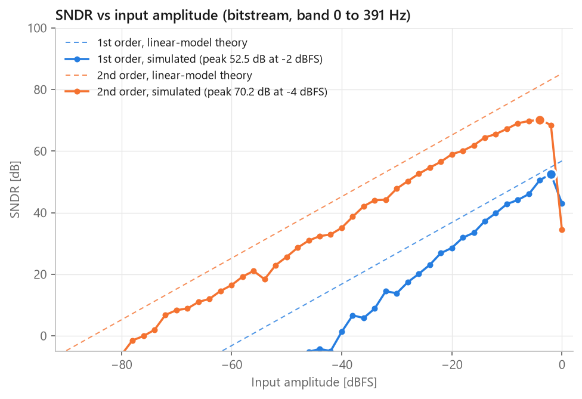
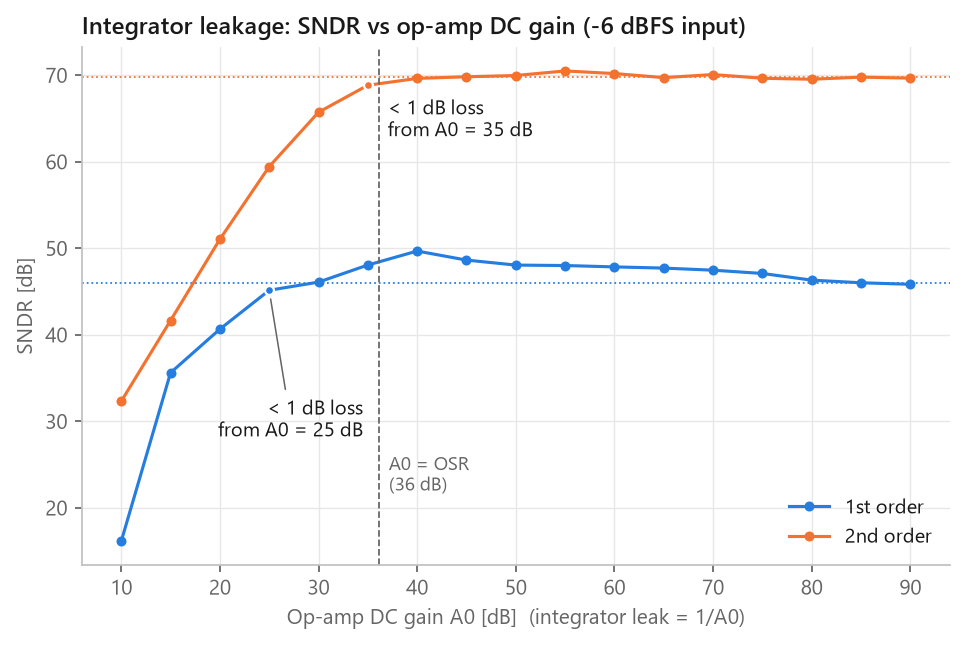
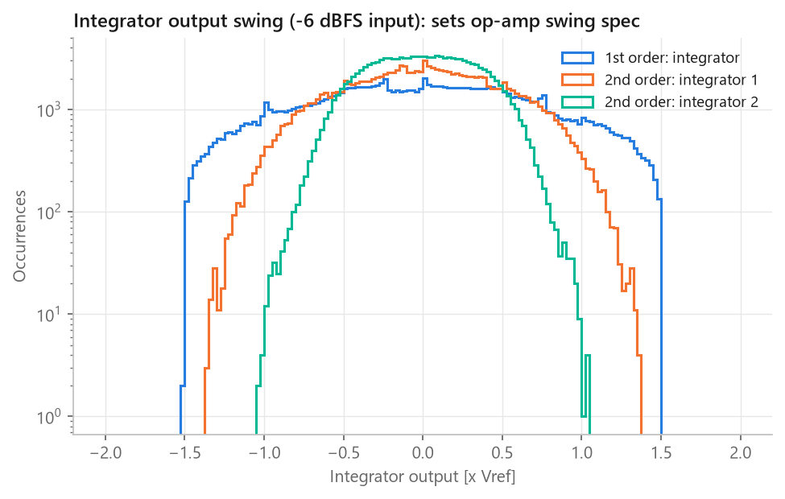
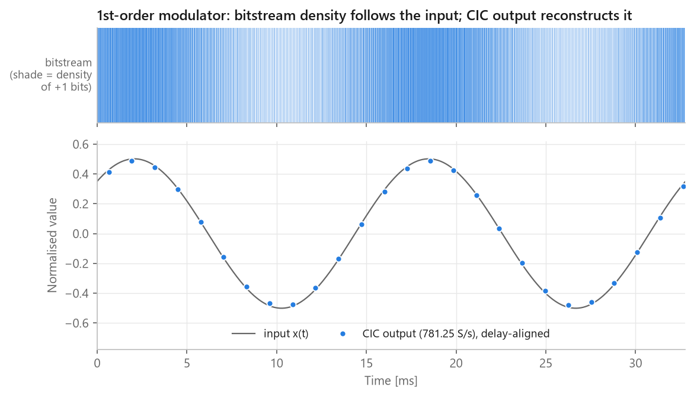
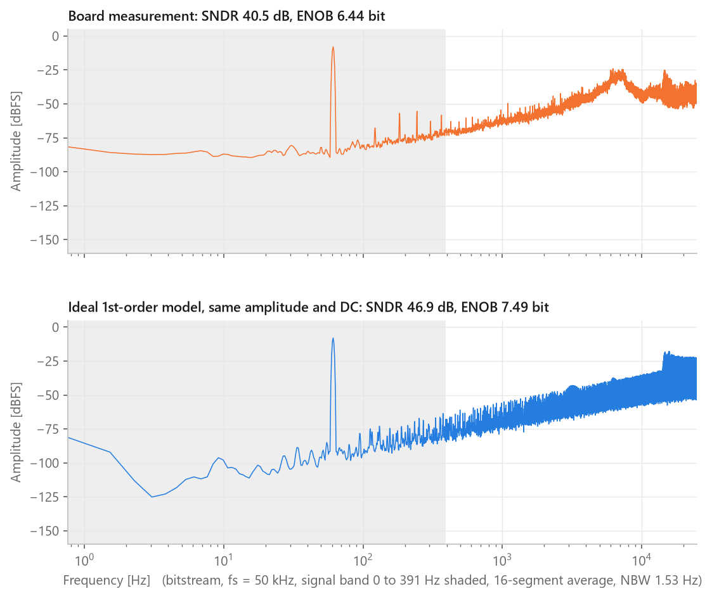
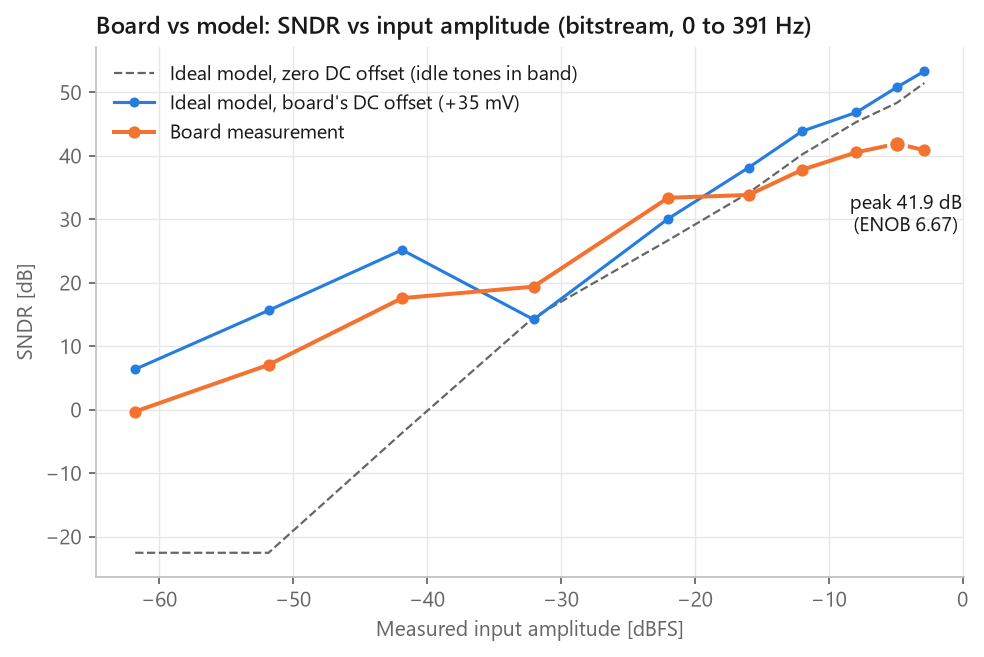

# Capacitive MEMS sensor interface: a ΣΔ ADC from model to board

A sigma-delta (ΣΔ) ADC for low-bandwidth sensor signals, taken through the same
flow used for a mixed-signal IC: **spec → behavioural model → hardware prototype
with real measurements → (next) transistor-level design in SKY130.**

| Part | What | Status |
|---|---|---|
| 1. System model | 1st- and 2nd-order ΣΔ modulators, CIC decimation, FFT metrics, non-ideality sweeps (Python) | **Done**: results below |
| 2. Board prototype | Discrete 1st-order modulator (MCP6002 integrator + comparator) closed by an STM32F746 that acts as clocked latch, 1-bit DAC and real-time CIC decimator | **Done: built and measured on the bench**, results below |
| 3. IC design | 2nd-order switched-capacitor modulator in SKY130 (Xschem, ngspice, Magic, Netgen) | **Planned, not started**: first-cut specs derived from Part 1 below |

Nothing in this repository claims silicon or measured results that do not exist yet.

---

## Architecture

```
            ┌──────────── analog (breadboard) ─────────────┐   ┌──────── STM32F746 @ 216 MHz ────────┐
 Vin ──R──┐ │                                              │   │                                      │
          ├─┤ integrator (MCP6002 A) ──► comparator (B) ───┼──►│ latch @ fs = 50 kHz (TIM1 IRQ)        │
 FB ───R──┘ │   RC = 1 ms                                  │   │   │                                  │
   ▲        └──────────────────────────────────────────────┘   │   ├──► FB = bit (GPIO = 1-bit DAC)   │
   └───────────────────────────────────────────────────────────┤   │                                  │
                                                               │   └──► CIC, K = 3, R = 64 ──► 781 S/s │──► USB (ST-LINK VCP)
                                                               └──────────────────────────────────────┘
```

| Parameter | Value |
|---|---|
| Sampling clock fs | 50 kHz |
| Oversampling ratio (OSR) | 64 |
| Signal band | 0 to 390.6 Hz (accelerometer / slow sensor band) |
| Output rate | 781.25 S/s |
| Decimator | CIC, order 3, R = 64 (Hogenauer, integer, bit-exact firmware ↔ Python) |
| Quantizer / DAC | 1 bit |
| Test tone | 61.0 Hz, chosen so its harmonics avoid the 50 Hz mains harmonics and the tone is not a sub-multiple of fs |

## Part 1: system model results

Bitstream metrics use a 2^20-sample record (21 s, the same length as one board
capture), a Blackman-Harris window, and the 0 to 390.6 Hz band.

| Metric | 1st order | 2nd order |
|---|---:|---:|
| Theory, peak SQNR (linear noise model, 0 dBFS) | 56.8 dB | 85.2 dB |
| Simulated SNDR, bitstream, −6 dBFS | 46.2 dB | 69.7 dB |
| Simulated ENOB, bitstream, −6 dBFS | 7.4 bit | 11.3 bit |
| Simulated SNDR, after CIC, −6 dBFS | 51.1 dB | 74.5 dB |
| SFDR, −6 dBFS | 53.8 dB | 81.2 dB |
| Peak SNDR (amplitude sweep) | 52.5 dB at −2 dBFS | 70.2 dB at −4 dBFS |
| Minimum op-amp DC gain for < 1 dB SNDR loss | 25 dB | 35 dB |



What the model shows:
- **Noise shaping:** the quantization noise rises at 20 dB/decade (1st order) and 40 dB/decade (2nd order), as the NTFs (1 − z⁻¹) and (1 − z⁻¹)² predict.
- **1st order falls short of the linear model** by 5 to 15 dB. Its quantization error is strongly correlated with the input (pattern noise and idle tones), and the white-noise model ignores that. This is the textbook reason to go to 2nd order for the IC.
- **2nd order peaks at −4 dBFS and collapses at 0 dBFS** (68.5 dB at −2 dBFS, 34.6 dB at 0 dBFS), so the usable input range is set by loop stability, not by the reference.
- **After-CIC SNDR is higher than the bitstream SNDR** because the sinc³ droop (−11.8 dB at the band edge) also attenuates the shaped noise, which is largest at the band edge. A FIR droop-compensation stage would trade some of that back for a flat passband.
- **Test-signal design:** a tone at exactly fs/800 = 62.5 Hz makes the error periodic and costs about 6 dB of SNDR. The firmware therefore uses a 32-bit DDS at 61.0 Hz, and the model uses the same frequency.




### First-cut specs for Part 3 (derived, not yet designed)

| Spec | Value | Source |
|---|---|---|
| Op-amp DC gain | ≥ 35 dB (design target ≥ 50 dB for PVT margin) | leakage sweep (fig. 3); matches the A0 ≈ OSR rule |
| Integrator output swing | up to 1.37 × Vref (2nd order, Boser–Wooley 0.5/0.5 scaling) | state histogram (fig. 4) |
| Sampling capacitor | ≥ 0.21 pF for 80 dB thermal SNR at −6 dBFS (fully differential, 1 V peak diff. full scale, kT/C noise 4kT/(Cs·OSR)) | first-order kT/C budget; matching will likely set a larger value |




## Part 2: board prototype

- Analog loop filter on a breadboard: MCP6002 half A as the integrator (R = 10 kΩ, C = 100 nF), half B as the comparator, 1.65 V mid-supply reference.
- STM32F746G-DISCO, **register-level firmware (CMSIS only, no HAL)** in [firmware/src/main.c](firmware/src/main.c). One 50 kHz interrupt does all of it:
  1. latches the comparator and drives the 1-bit DAC (FB = bit),
  2. generates the test sine: the Disco's DAC pins are not on its headers, so a TIM1 PWM at exactly fs (ripple aliases to DC) is driven by a DDS with first-order error feedback on the duty cycle, i.e. a small digital ΣΔ, filtered by two RC stages,
  3. runs the CIC decimator in real time, with wrapping 32-bit arithmetic that is bit-exact with [sdm/cic.py](sdm/cic.py).
- Captures (2^20 bits plus the decimated samples) go to the PC with a checksum. The PC checks the on-chip CIC against the Python CIC sample for sample, then computes SNDR/ENOB/SFDR next to the ideal model at the same measured amplitude.
- Build, wiring and measurement guide: **[docs/wiring.md](docs/wiring.md)**.

### Measured results (breadboard, 2026-11-25)

Every number below comes from real captures (raw data in [data/](data/), analysis in
[results/board/](results/board/)). In all 11 captures the CIC output computed on the
STM32 matched the Python CIC bit for bit. The comparison model is the ideal 1st-order
modulator driven at the board's measured operating point: the same tone amplitude and
the same DC offset.

| Metric (61 Hz tone at −7.9 dBFS, band 0 to 391 Hz) | Ideal model, same operating point | Board |
|---|---:|---:|
| SNDR, bitstream | 46.9 dB | **40.5 dB** |
| ENOB, bitstream | 7.5 bit | **6.4 bit** |
| SFDR | 55.7 dB | **47.4 dB** |
| THD | −81.2 dB | **−43.4 dB** |
| SNDR after the on-chip CIC | | 44.9 dB (7.2 bit) |
| Peak SNDR over the amplitude sweep | 53.3 dB at −2.9 dBFS | **41.9 dB at −4.9 dBFS** (6.7 bit) |
| Idle channel: in-band noise / 50 Hz spur | | −63.1 dBFS / −85 dBFS |
| DC offset | | +35 mV |




What the measurements show:
- **At −8 dBFS the board is 6.4 dB below the ideal model**, with one op-amp package, a few passives and a GPIO pin as the DAC. Noise shaping is clearly visible in the spectrum.
- **Low amplitudes (−62 to −42 dBFS): about 8 dB below the model.** The board's in-band floor is flat rather than shaped below ~30 Hz, consistent with analog noise (op-amp, resistors, 3.3 V supply through the GPIO DAC) rather than quantization noise.
- **High amplitudes: distortion takes over.** At −4.9 dBFS the harmonics HD2 to HD6 add up to −44 dBc, more than half of the noise-plus-distortion power, so SNDR peaks at 41.9 dB and falls at −2.9 dBFS while the model keeps rising. This setup cannot yet say whether the harmonics come from the PWM test source or from the modulator (GPIO DAC rise/fall asymmetry, slow comparator). Benchmarking the test signal with the ADS1015 (planned) would separate the two.
- **A noise hump at 6 to 7 kHz that the model doesn't have.** This is consistent with the op-amp used as a comparator (MCP6002, 1 MHz GBW): with only a few mV of overdrive it can take a large part of the 20 µs sample period to switch, which adds loop delay and reshapes the out-of-band noise. A real comparator is the first hardware upgrade.
- **The DC offset helps at low amplitude.** With zero offset, an ideal 1st-order modulator puts idle tones in band (dashed line: −22 dB SNDR at −62 dBFS). The board's +35 mV offset, most likely from the tolerance of the 10 kΩ reference divider, moves its idle tone to about 1.05 kHz and its harmonics, above the 391 Hz band ([idle spectrum](results/board/idle_spectrum.png)). This is the classic 1st-order idle-tone problem, and one more reason to use 2nd order for the IC.
- **Debugging note:** the first captures lost about 1 ms of data per frame on the 921,600-baud serial link. The cause was on the PC side: changing the pyserial timeout in the middle of a frame re-applies the port configuration on Windows, and the ST-LINK USB bridge drops the bytes in flight. The timeout is now set once while the line is idle, and the capture retries automatically.

## Reproduce

```powershell
python -m pip install -r requirements.txt
python model/run_model.py          # Part 1: figures + results/model/summary.md (~20 s)
python pc/selftest.py              # PC pipeline test with a synthetic firmware frame
firmware\build.ps1                 # firmware, uses the toolchain bundled with STM32CubeIDE
python pc/capture.py --amp-db -6   # Part 2: one capture from the board (see docs/wiring.md)
python pc/analyze.py --sweep "data/sweep_*.npz"   # re-analyse the saved board captures, no hardware needed
```

## Repository layout

```
sdm/        modulator models, bit-exact CIC, FFT metrics (shared by model and measurement)
model/      Part 1 system model script
pc/         serial capture, analysis, hardware-free self-test
firmware/   STM32F746G-DISCO firmware (CMSIS, Makefile, build/flash scripts)
docs/       wiring and measurement guide
results/    model/ (simulated), board/ (measured only)
data/       raw board captures (.npz)
```

## Roadmap

1. Board follow-ups: measure the PWM test signal with the ADS1015 to separate source distortion from modulator distortion; replace the op-amp comparator with a real comparator; film integrator capacitor.
2. Part 3: 2nd-order switched-capacitor modulator in SKY130 (op-amp, comparator, non-overlapping clocks), PVT corners and Monte Carlo, layout DRC/LVS-clean, post-layout simulation; CIC in Verilog with cocotb tests against `sdm/cic.py`.
3. Extras: PDM MEMS microphone decoded with the same CIC; 433 MHz wireless sensor node (Velleman WPI469); KiCad board design.
